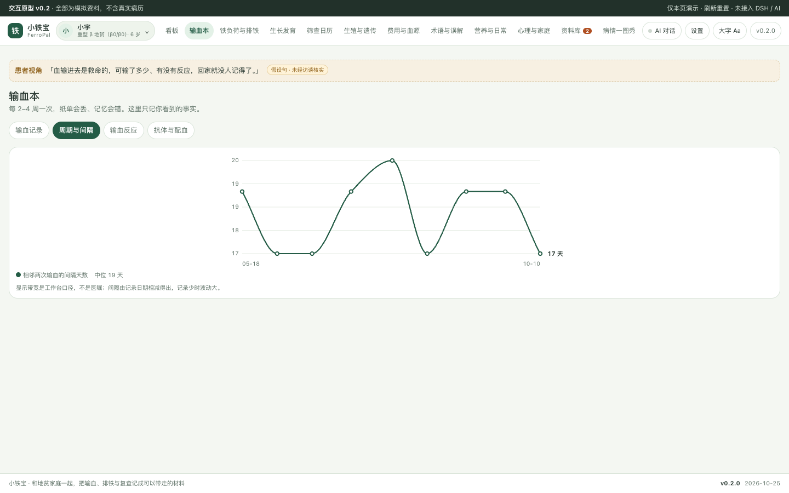
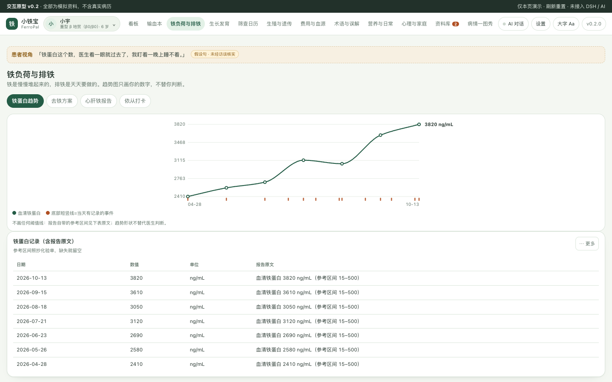
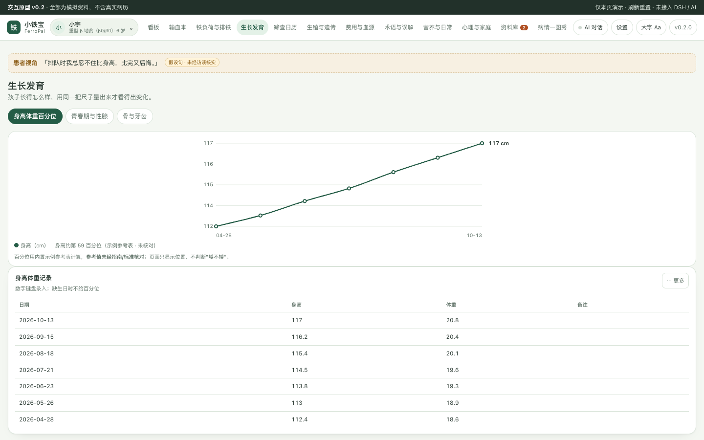
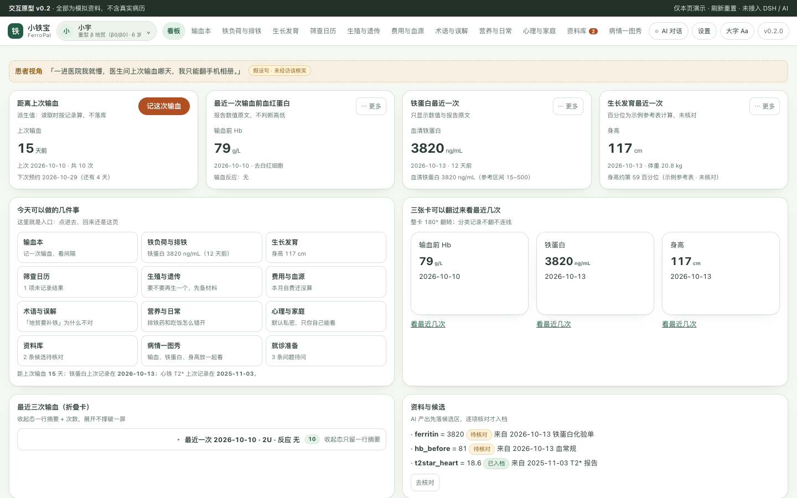
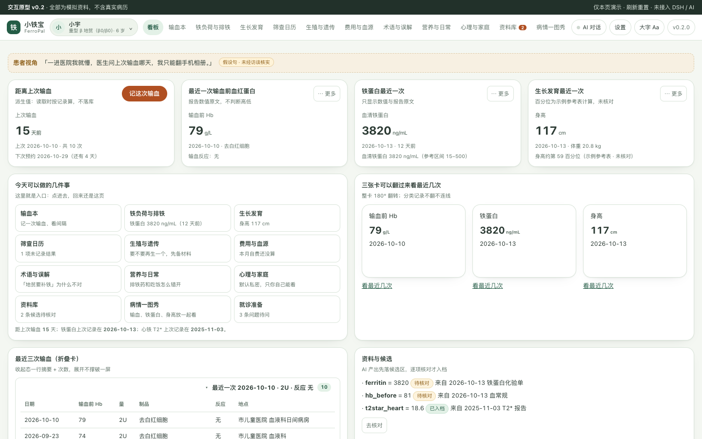
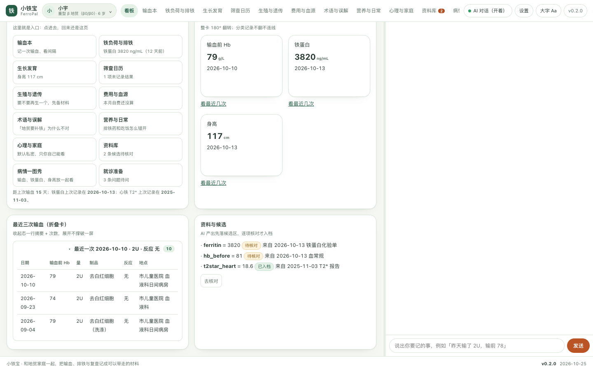
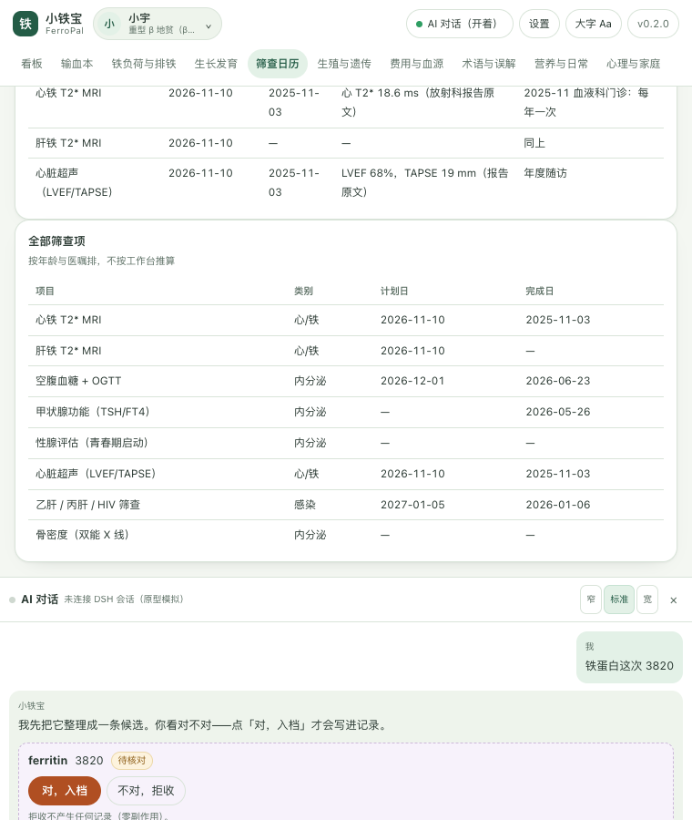
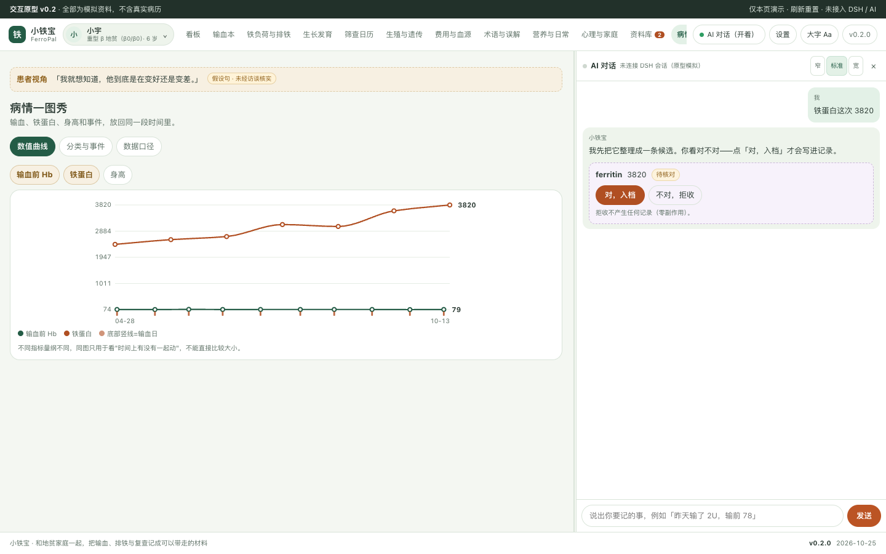
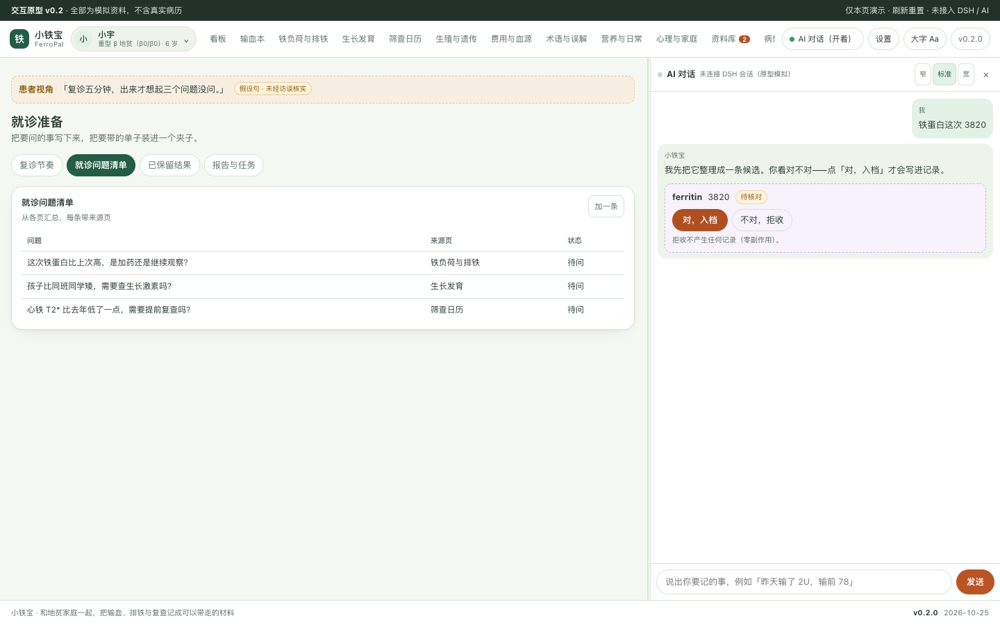

# 小铁宝 FerroPal · 重型地中海贫血（输血依赖型）工作台

给地贫家庭用的信息整理工具：**记输血、记铁蛋白、记生长、把复诊材料理出来**。
不做诊断、不给治疗与用药建议、不判断指标高低、不预测预后。数据全部在本机。

- 原型版本 **v0.2**（可 `file://` 直接打开）· 包版本 `0.2.0` · 构建 2026-10-25
- 样板基准：`cervical-workbench`（client 链路）· 成熟基准：`breast-cancer-workbench`（26 号口径）
- 认领 Issue：[#34](https://github.com/xyb-openharness-dsh-plugins/.github/issues/34)

> **2026-10-25 独立评审更新（优先于下方历史截图与自测数字）**
> 评审检出 **6 条 P0，G2 不建议签认**；既有绿色测试不能证明持久化、整页入口、AI 携带上下文与临床匹配闭环已实现。详见 [独立评审](docs/DESIGN-REVIEW.md) 与 [试验建档/匹配缺口](docs/TRIAL-MATCHING-GAP.md)。
> 用户新增的分类 3D 指标卡、一图秀指标选择窗及地贫个人资料—临床试验匹配正在修订，**尚未完成验收**。下方截图为旧版，不代表当前开发页或已安装版。
> `unified_search_trials` 本机目录已存在，但存在不代表 MCP 注册、来源就绪或查询成功；当前临床资产仍为未查询空库。暂停发布及 BACKLOG 完成态回填。
>
> **原型阶段历史说明（含待纠正项，不作为当前验收）**
> ① **0 访谈**：所有患者场景句都是 `hypothesis`（疾病轴推导），界面已标「假设句 · 未经访谈核实」；
> ② **指南已取得原件**：G1 出处层（24 条，含页码/表号/≤200 字符摘录）与 G2 节奏层已启用；
> **G3 分级层有意不启用**（不判读，见 [METRIC-GRADING](docs/METRIC-GRADING.md)）；
> ③ 临床试验库**未查过**（工具目录已存在，实际查询就绪待核验）；④ MinerU **未实测**；⑤ 装机 V2/V3 **未做**。

## 关键功能

**看板：回答"今天该做什么"**——距上次输血多少天、铁蛋白上次什么时候记的、还有几条问题要问；下面是 12 个入口，点进去、回来还是这页。


**输血本 · 周期与间隔**——每 2–4 周一次的输血，最后只剩"上次是哪天"能记住。这里把间隔算成一条线，并明说"显示带宽是工作台口径，不是医嘱"。


**铁负荷与排铁 · 铁蛋白趋势**——只画你自己的数字，**不画阈值线**；底部短竖线是当天发生的事（输血/复查），分类事件不进曲线。


**生长发育**——身高曲线 + "约第几百分位"，并常驻一句"参考值未经指南/标准核对"；页面不判断"矮不矮"。


**折叠卡（收起态）**——一次住院/一次输血 episode 收起成一行摘要 + 次数。


**折叠卡（展开态）**——展开后明细在同一张卡里，不撑破一屏。


**AI 只出候选，你点头才入档**——AI 把话整理成一条候选，点「对，入档」才写记录；点「不对，拒收」零副作用。


**窄宽 760px**——顶栏换行但导航保留文字，标签不竖排、不横向溢出。


**病情一图秀**——输血、铁蛋白、身高放回同一段时间；不同量纲同图只用于看"时间上有没有一起动"。


**就诊准备 · 问题清单**——每条问题带来源页，导出的 Markdown 里也带；这是这个工作台真正要交付的东西。


## 怎么用

原型（现在就能看）：

```bash
open ~/Downloads/thalassemia-workbench/prototypes/v0.2/index.html   # file:// 直开，无构建
```

装机（M6 之后才成立，现在**未做**）：

```bash
# 目标版本发布后，用 release/ 里的 tgz 装进 Desktop 的 harness profile；
# 装完必须重启，并在**新建会话**里打开工作台（宿主按会话授权）。
```

## 数据与口径

- 演示数据**唯一源**：`demo/build-demo-data.mjs` → 同时产出 `demo/demo-data.sqlite` 与 `prototypes/v0.2/demo-data.js`；
  重跑字节一致（固定种子 + 固定窗口 `2026-10-25`）。
- 两个演示档案：A 为 6 岁患儿（家长代记），B 为 24 岁成年患者（本人记录）——R3「本人/代记」双视角。
- 全部为**构造数据**，不含任何真实病历；单位：Hb g/L、铁蛋白 ng/mL、身高 cm、金额元。
- 医学口径：只记录报告原文与数值，**不做判读**；参考区间缺失就留空，不替用户补通用区间。
- 临床研究：现有库**未查过**，不编造条目。工具目录存在，注册/通道查询另行实测；0 条不代表本病没有研究。

## 开发

```bash
npm run check                      # 静态包合同（staticPass 必须 true）
node scripts/measure-diff.mjs      # 重名率实测：一级 46.2% / 二级 20%（阈值 70%）
node scripts/probe-prototype.mjs   # 26 条断言：穷举 58 个 (view,sub)、窄宽、面板、折叠、字号
node scripts/check-hvt.mjs         # HVT X1–X4：孤儿页 0 / 路径走通 / 编辑入口 ≤1 / 候选闭环
node scripts/shots.mjs             # 重出 README 截图（33 号）
npm run audit                      # 家族一致性（版本/面板/检查链/文档）
```

文档索引：[SPEC](docs/SPEC.md) · [DEV-REQUIREMENTS](docs/DEV-REQUIREMENTS-2026-10-25.md) · [DIFF-MATRIX](docs/DIFF-MATRIX.md) ·
[PATIENT-FLOW](docs/PATIENT-FLOW.md) · [INTERACTION-DESIGN](docs/INTERACTION-DESIGN.md) · [SCHEMA](docs/SCHEMA.md) ·
[METRIC-GRADING](docs/METRIC-GRADING.md) · [GUIDELINE-BRIDGE](docs/GUIDELINE-BRIDGE.md) · [DEV-PLAN](docs/DEV-PLAN.md)

## 许可与声明

本工具用于患者信息整理，不构成医疗建议。NCCN® 为美国国家综合癌症网络注册商标，本仓库与 NCCN 无关联；
重型地中海贫血不属于 NCCN 癌种目录，本项目范围参照《86 个罕见病病种诊疗指南（2025 年版）》病种目录（#78），
**不复制其临床内容**。Thalassaemia International Federation (TIF) 2021 TDT 指南（4th ed，ISBN 9789963717187）
仅做书目级引用，正文未能取得。
